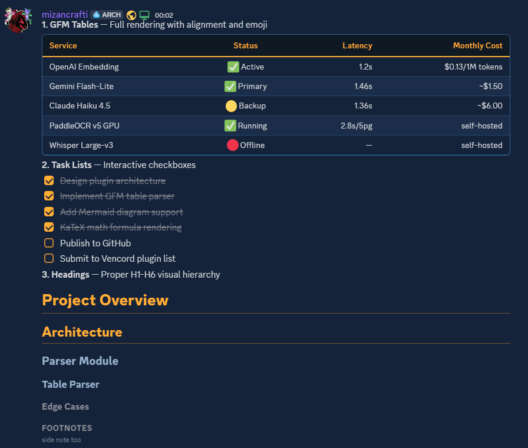
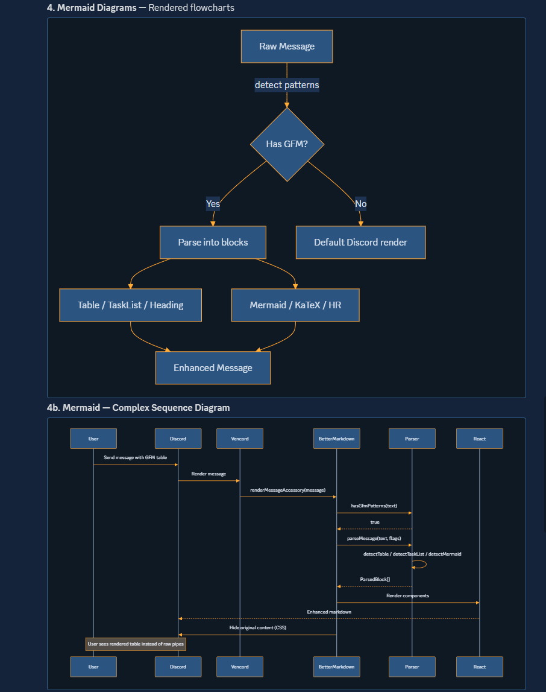
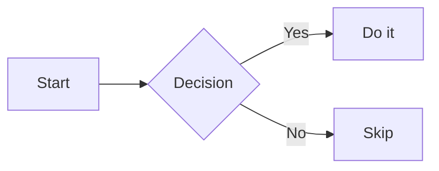

# BetterMarkdown

A [Vencord](https://vencord.dev/) userplugin that enhances Discord's markdown rendering with full GitHub Flavored Markdown (GFM) support, Mermaid diagrams, KaTeX math formulas, and a few extras (`-#` subtext, color swatches, native-looking code blocks with a copy button).

## Features

| Feature | Syntax | Description |
|---|---|---|
| **GFM Tables** | `\| h1 \| h2 \|` | Full table rendering with alignment. Tables split across several messages get their header back from the previous messages |
| **Task Lists** | `- [x] Done` | Read-only checkboxes for todo items |
| **Headings** | `# H1` – `###### H6` | Proper visual hierarchy (Discord renders all as bold). Also work inside nested blockquotes |
| **Horizontal Rules** | `---`, `***`, `___` | Styled divider lines |
| **Footnotes** | `[^1]` + `[^1]: text` | Superscript references with click-to-scroll definitions |
| **Nested Blockquotes** | `> > > text` | Depth-colored borders (blurple → green → yellow → red). Headings, `-#` subtext and code blocks work inside them |
| **Mermaid Diagrams** | `` ```mermaid `` | Flowcharts, sequence diagrams, etc. via CDN |
| **KaTeX Math** | `$E=mc^2$`, `$$...$$` | LaTeX math rendering via CDN |
| **Subtext** | `-# small text` | Discord's small, muted text — also inside nested blockquotes and enhanced messages |
| **Code blocks** | `` ```bash `` | Rendered by Discord's own renderer (highlighting, same look) with a working copy button in the top-right corner |
| **Color swatches** | `#F7F6F3` | A small filled square next to every hex color (`#RGB`, `#RRGGBB`, `#RRGGBBAA`) |

## Screenshots

### Tables, Task Lists, Headings, Mermaid Flowchart, HR, Mixed Content


### Large Table (8×8), Sequence Diagram, Architecture Diagram


## How It Works

BetterMarkdown uses Vencord's `renderMessageAccessory` API to render enhanced content as a message accessory, and hides the original text with CSS:

1. Checks raw message text for GFM/enhanced patterns (fast regex gate). Code blocks are ignored by the gate, so a `# comment` or a `|` inside a ```` ```bash ```` block never triggers anything
2. If patterns found → parses into typed blocks, renders with React components
3. Renders a per-message `<style>` rule next to the content: `#message-content-<id> { display: none }`. It is scoped by id on purpose: a generic "hide any `message-content-*` inside a message with enhanced content" rule also hid the text of messages that merely *contain* another rendered message (e.g. the MessageLinkEmbeds plugin)
4. Moves the enhanced block to the top of the accessories container (`order: -1`), so attachments, embeds and stickers stay *below* the text, like in the original message
5. If no patterns → does nothing (**zero overhead**)

**Code blocks:** every ```` ``` ```` block is handed to Discord's own markdown renderer, so it looks and highlights exactly like a native one. The native copy button doesn't work outside Discord's message renderer, so it is hidden and replaced by a working one (copies only the code, without the fences). Blocks inside nested blockquotes and blocks with text before the fence on the same line (`text: ```bash`) are supported too. The only exceptions: ```` ```mermaid ```` blocks become diagrams, and **plain** ```` ``` ```` blocks (no language tag) that contain a **table** are unwrapped and rendered as a table.

**Tables split across messages:** a message that starts with table rows but has no header of its own is treated as a continuation. The plugin looks at the previous messages by the same author (up to 20), finds the last table header + separator, and puts it in front, so the continuation renders as a normal table (with the original column names and alignment) instead of a headerless one.

Discord's existing markdown (bold, italic, code, spoilers, mentions, emoji) is fully preserved — inline formatting within enhanced blocks uses Discord's own `simple-markdown` parser.

## Installation

### As a Vencord userplugin

1. Clone or copy the `betterMarkdown` folder into `src/userplugins/`:

```
src/userplugins/
└── betterMarkdown/
    ├── index.tsx          # Plugin definition + renderMessageAccessory
    ├── style.css          # Styles using Discord CSS custom properties
    ├── katex-loader.ts    # CDN loader for KaTeX
    ├── mermaid-loader.ts  # CDN lazy-loader for Mermaid
    ├── parser/            # Modular parsers (one per feature)
    │   ├── index.ts       # Orchestrator + fast detection
    │   ├── table.ts       # GFM tables + headerless continuation
    │   ├── taskList.ts
    │   ├── heading.ts
    │   ├── hr.ts
    │   ├── footnote.ts
    │   ├── blockquote.ts
    │   ├── math.ts        # LaTeX $...$ and $$...$$ extraction
    │   ├── mermaid.ts     # ```mermaid block extraction
    │   ├── colors.ts      # Hex color detection
    │   └── tableContinuation.ts  # Header lookup for tables split across messages
    └── components/        # React components
        ├── Table.tsx
        ├── TaskList.tsx
        ├── Heading.tsx
        ├── Hr.tsx
        ├── Footnote.tsx
        ├── Blockquote.tsx
        ├── Math.tsx       # KaTeX inline + block rendering
        ├── Mermaid.tsx    # Mermaid diagram rendering
        ├── CodeBlock.tsx  # Code blocks via Discord's parser + copy button
        ├── ColorSwatch.tsx  # Color square next to hex colors
        └── shared.tsx     # renderInline() via Discord's parser
```

2. Build Vencord: `pnpm build`

### For Vesktop

After building, copy the dist files into Vesktop's vencord directory:

```bash
cp dist/vencordDesktop*.js dist/vencordDesktop*.css \
   ~/Library/Application\ Support/vesktop/sessionData/vencordFiles/
```

Then restart Vesktop (Cmd+Q → reopen).

## Settings

All features can be individually toggled in **Vencord Settings → Plugins → BetterMarkdown** (no restart required):

- **Enable Tables** — GFM table rendering (default: on)
- **Enable Task Lists** — Checkbox rendering (default: on)
- **Enable Headings** — H1–H6 hierarchy (default: on)
- **Enable Horizontal Rules** — Styled `<hr>` (default: on)
- **Enable Footnotes** — Reference/definition footnotes (default: on)
- **Enable Nested Blockquotes** — Visual depth for `> >` (default: on)
- **Enable Math** — KaTeX formula rendering (default: on)
- **Enable Mermaid** — Diagram rendering (default: on)
- **Enable Color Swatches** — Color square next to hex colors (default: on)
- **Theme** — Discord Dark (default), Discord Light, or GitHub

## Syntax Examples

### Tables

```
| Name | Role | Status |
|:-----|:----:|-------:|
| Alice | Dev | Active |
| Bob | PM | Away |
```

Alignment: `:---` left, `:---:` center, `---:` right.

Long tables get cut into several messages (Discord's 2000 character limit). Only the first message has the header, the next ones are just rows:

```
| Alice | Dev | Active |
| Bob | PM | Away |
```

These continuations are rendered as normal tables: the header and alignment are recovered from the previous message(s) by the same author. If the header can't be found, they render as a headerless table.

A table inside a plain ```` ``` ```` block is rendered as a table too.

### Task Lists

```
- [x] Write parser
- [x] Build components
- [ ] Test in Discord
- [ ] Ship it
```

### Mermaid Diagrams

````

````

### Math (KaTeX)

Inline: `$E = mc^2$`

Block:
```
$$
\int_0^\infty e^{-x^2} dx = \frac{\sqrt{\pi}}{2}
$$
```

### Footnotes

```
This claim needs a source[^1].

[^1]: Journal of Computer Science, 2024
```

### Nested Blockquotes

```
> Top level
> > Nested response
> > > Even deeper
```

### Subtext

```
-# Small muted text
> > -# Also works inside nested blockquotes
```

### Headings and code inside nested blockquotes

````
> > # Heading inside a nested quote
> > ```bash
> > echo "code block inside a quote"
> > ```
````

### Color swatches

```
Palette: #F7F6F3 background, #173F66 titles, #4A91C8 lines
```

Each hex color gets a small square filled with that color. Colors inside code blocks and links are left alone. 3-digit values need at least one letter (`#fff` yes, `#123` no) so issue numbers aren't treated as colors.

## Technical Notes

### Architecture

```
Message ──→ renderMessageAccessory(props)
               │
               ▼
         hasGfmPatterns(text, flags)
               │
          false │ true
               │   │
     (no-op)   │   ▼
               │ parseMessage(text, flags) → ParsedBlock[]
               │   │
               │   ▼
               │ EnhancedMarkdownAccessory (React)
               │   ├── Table / TaskList / Heading / Hr
               │   ├── Footnote / Blockquote
               │   ├── Math (KaTeX CDN) / Mermaid (CDN)
               │   └── Text blocks via renderInline()
               │   │
               │   ▼
               │ per-message <style>:
               │   #message-content-<id> { display: none }
               │ (+ order: -1 so attachments stay below the text)
               │
               ▼
         Enhanced Message (or nothing)
```

### Performance

- **Detection is O(n)** on message length — simple regex tests
- **Parsing only runs** when GFM patterns are detected
- Messages without GFM syntax have zero overhead
- KaTeX is preloaded at plugin start; Mermaid is lazy-loaded on first use

### Dependencies

- **KaTeX** — loaded from jsDelivr CDN (`katex@0.16.21`)
- **Mermaid** — lazy-loaded from jsDelivr CDN (`mermaid@11`)
- No bundled heavy dependencies

### Styling

All CSS uses Discord's custom properties for native look-and-feel:
- `--background-secondary`, `--background-tertiary`
- `--text-normal`, `--text-muted`
- `--interactive-active`, `--brand-500`

Class prefix: `bm-` (e.g. `bm-table`, `bm-heading-2`)

### Limitations

- Enhanced rendering is client-side only — other users see raw markdown
- Code blocks are left to Discord's renderer; only plain `` ``` `` blocks (no language) containing a table are unwrapped. A table inside `` ```md `` stays as code
- Standard tables require the separator row (`|---|---|`)
- Tables split across messages: the header is only found in previous messages by the same author (up to 20 back, and they must be loaded). Otherwise the fragment renders as a headerless table. A row cut in half between two messages isn't joined
- Messages with hex colors are re-rendered by the plugin (like messages with tables), so some details may differ slightly from Discord's native rendering
- The copy button replaces Discord's native one by hiding any element inside a code block whose class contains `copy` or `codeActions`; if Discord renames those classes, both buttons may show
- Mermaid and KaTeX require internet access for CDN loading

### Graceful Degradation

- If a parser fails, the original content is preserved (try/catch)
- If the per-message hide rule doesn't match, both original and enhanced content show
- If CDN loading fails, math/diagrams render as raw text

## License

MIT
